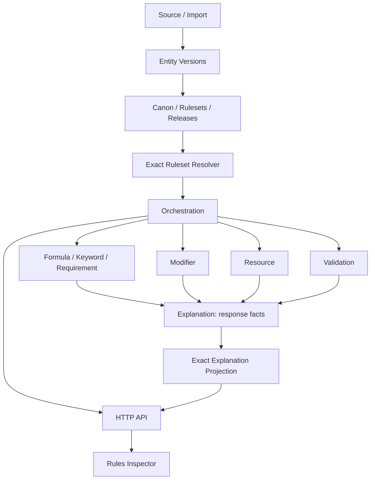
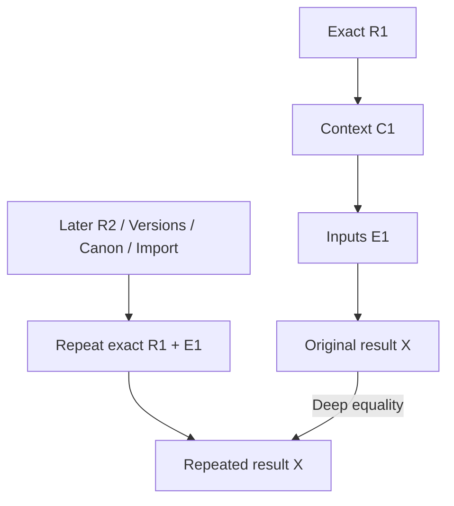
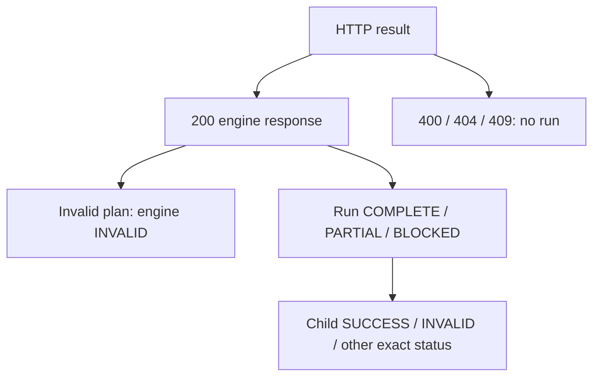
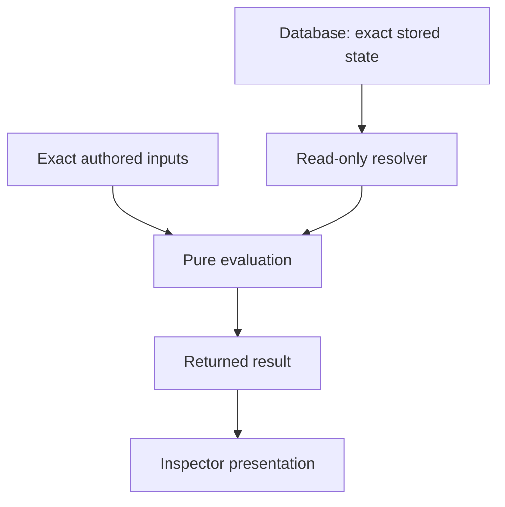
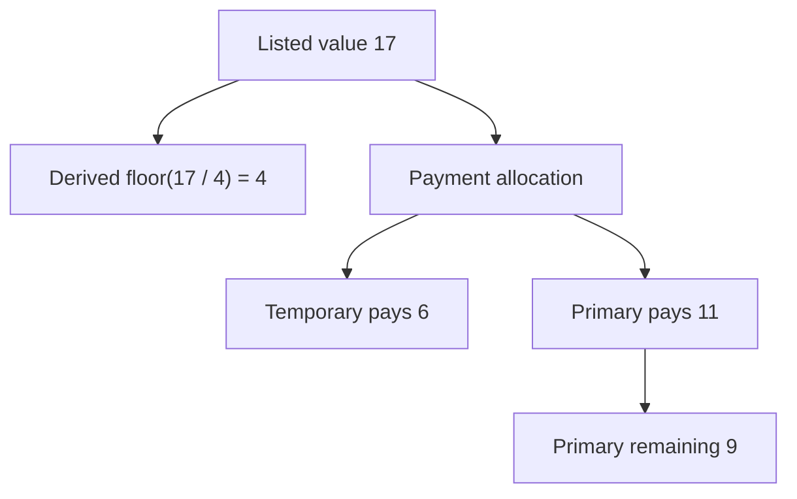

# M4 Final Integration & Reproducibility Audit — M4-WO12

## 1. Executive Summary

**M4 FINAL AUDIT — READY FOR CI VERIFICATION.** WO12 audits the approved M4 foundation and fixes three demonstrated plain-data/contract-boundary defects. It adds no product feature, mechanic, route, schema, migration or persistence. Local quality, pure-engine and presentation checks pass; database and browser acceptance remain pending permanent GitHub CI on the merged result. **M4 is not COMPLETE or FINAL PASS yet.**

## 2. Scope

WO1–WO11, including WO10A, are audited as one exact-context system. New work consists of static/invariant audits, integration fixtures, security and limit regressions, mutation controls, browser assertions and this handoff. Prowess-specific compilers and M5 mechanics are excluded. No supplied rulebook, source DOCX/PDF or archive is committed.

## 3. Baseline Commit

GitHub `main` was verified before editing: `4ef1ad522f0af4a2cbb71afbca1f410da8141d5c`, the approved WO11 merge. Work is isolated on `m4-wo12`. No unrelated main history is rewritten.

## 4. M4 Work Order Inventory

| Order | Responsibility | Final guard |
| --- | --- | --- |
| WO1 | Contracts, contexts, response, trace and purity | Core suites + WO1 static |
| WO2 | Exact Manifest/Release resolution | Resolver static/database + final history |
| WO3 | Formula grammar/evaluation/dependencies | Formula suites + WO3 static + limits |
| WO4 | Exact keyword metadata | Keyword suites + static/database + final HTTP |
| WO5 | Requirement predicates/facts | Requirement suites + static + final HTTP |
| WO6 | Modifier targets/order/stacking/signals | Modifier suites + static + limits |
| WO7 | Resource transitions/reservation/payment | Resource suites + static + golden |
| WO8 | Explicit validation aggregation | Validation suites + static + limits |
| WO9 | Trace-backed canonical explanation | Explanation suites + static + limits |
| WO10 | Closed orchestration and HTTP | Orchestration/static/HTTP + final history |
| WO10A | Exact-document projection | WO10 projection regressions, WO11 static and final golden |
| WO11 | Developer Rules Inspector | Component/static/real HTTP browser workflows |
| WO12 | Integrated final audit | Named permanent final gate, preserving earlier gates |

## 5. Final Architecture

The orchestrator dispatches approved primitives. Explanations consume returned responses, and projection consumes an exact existing document. The diagram shows data/response dependencies; an authored plan explicitly selects its operations and bindings.

## 6. Package Dependency Audit

| Package/layer | Allowed dependency or role | Forbidden behavior |
| --- | --- | --- |
| `@prowess/rules` | `@prowess/model` only | DB/import/React/Next/Prisma/network/clock/randomness |
| Exact resolver in `@prowess/db` | Existing M2 readers and WO1 constructor | Recency selection, writes, alternate composition rules |
| HTTP adapter/service | Strict shape, one exact resolver, orchestrator, serialization/errors | Primitive mechanics, persistence, forged resolved contexts |
| Inspector | Metadata/type imports, existing API client, returned data | Primitive calls, math, rounding, generation/projection, persistence |

The architecture checker reports 11 boundary rules and seven packages without cycles. Runtime contract tables are now frozen; no mutable evaluator cache, registry, current Ruleset or last-evaluation singleton exists.

## 7. Manifest Reproducibility

The final HTTP fixture pins A1/B1 in M1, creates A2/B2 and M2 later, and deep-compares M1's complete original evaluation again. Existing resolver tests also preserve exact owner identities, aliases/canonical-key distinction and read-only fingerprints. New database assertions await CI.

## 8. Release Reproducibility

R1 is resolved and evaluated before later Versions, CanonDecision, RuleConflict, approved ChangeSet, M2, R2, MigrationPlan and source/import activity. The fixture compares complete engine/HTTP responses, exact context, child responses, traces, DETAILED and SUMMARY, rather than comparing only numeric values.

## 9. Release Immutability

The final fixture attempts every public Version lifecycle status, draft-content edit and authored Keyword assignment/removal on a Version reachable from R1. Legal protected-status transitions may change status; authored content never becomes editable and R1's evaluation remains identical. Existing M2 publication guards prohibit DRAFT-reachable published content and invalid reverse transitions. No lifecycle redesign is introduced.

## 10. Release Hash Integrity

Test-only composition and stored-hash tampering each produce controlled integrity refusal before a context/run exists. `finally` restores the stored rows. HTTP expects 409 with no engine data; the browser regression first obtains a successful result, tampers the hash, reruns, and requires prior timeline removal plus “evaluation did not run.”

## 11. Inheritance Audit

A Base → Child → Grandchild fixture retains explicit and inherited pins, exact source Ruleset/Manifest provenance and deterministic effective composition after later parent manifests. Existing M2 inheritance code remains the sole resolver; no M4 inheritance algorithm was added.

## 12. Ruleset Isolation

Concurrent exact Manifests from two Rulesets pin different Versions of the same Entity. The same SET_CONTAINS plan binds the exact version ID and yields independently correct true/false facts and provenance. Concurrent identical HTTP responses are deeply equal and every database table remains unchanged.

## 13. Context Audit

Ruleset/Actor/Build/Runtime normalization retains existing optional undefined/null semantics. Inputs remain caller-owned and unfrozen; normalized representations and public pure outputs are detached and frozen. Descriptor checks reject accessors, custom/sparse arrays and iteration overrides before executing caller code. Non-plain constructor getters are never read.

## 14. RuleEngineResponse Audit

All primitives, projection and orchestration retain WO1's single response contract and status vocabulary. An outer run status describes execution/dependencies; a child's INVALID or a business false remains independent. WO10A preserves WO9's direct null envelope Ruleset provenance while retaining exact document/section provenance; it never invents a context.

A legal case is HTTP 200, orchestration COMPLETE, Formula INVALID. Request failure never becomes a rendered successful prior run.

## 15. Formula Audit

Earlier suites exercise precedence, unary operators, floor/ceil/min/max, bounds, divide-by-zero, absent bindings, dependency cycles/order, identifiers, non-finite values and AST safety. Final tests cover exact source/token/node/nesting/depth maxima and one-over failures. Only declared Formula floor/ceil calls are permitted by the final rounding audit. Identifier/unit grammar metadata uses private matchers so exported metadata cannot rewrite validation.

## 16. Keyword Audit

Exact IDs, canonical keys, category identity, duplicates/conflicts, contributor provenance and code-unit ordering remain owned by WO4. The final HTTP plan uses an actual M1 KeywordDefinition, exact source provenance and a bound KEYWORD_PRESENT requirement. Metadata labels imply no numeric effects, cost changes or damage.

## 17. Requirement Audit

All approved predicate and group kinds retain representative coverage, including unsupported CUSTOM, context/fact/type failures. `satisfied=false` remains a successful business outcome. Final maximum node/group/depth tests reject oversize input explicitly. A real source mutation that auto-blocks false Requirements causes the permanent behavioral guard to fail.

## 18. Modifier Audit

All approved numeric, ordered-step and roll-signal operations retain earlier matrix coverage. Ordering remains phaseOrder → priority → order → modifierKey; ADD then MULTIPLY differs from its reverse. A fractional percentage result is never rounded implicitly. Target/modifier/ladder exact maxima and one-over cases execute in final coverage. Skipped conditions remain valid results.

## 19. Resource Audit

SPEND, RESTORE, SET_CURRENT, reserve/release capacity, refresh, preview and apply remain pure transitions. Reservation 20/18/6 yields reserved 6, available maximum 14, current 18. Failed payment of 10 from 6+2 preserves both sources and reports shortfall 2. Resource/source limits are accepted at maximum and rejected one over. APPLY returns projected data and never mutates a stored Character.

## 20. Validation Audit

Earlier matrices preserve ERROR/WARNING/INFO, PASS/FAIL/NOT_APPLICABLE, exact code/category/path/details/provenance and deterministic attribution. Requirement false, canPay false and skipped modifiers produce no new policy errors without explicit checks. Source/check/finding budgets have exact-max and one-over assertions, including 20,000 retained findings.

## 21. Explanation Audit

Canonical DETAILED consumes exact subsystem responses, including invalid/partial outcomes. It formats facts/traces without reevaluating mechanics. All supported contribution kinds retain coverage. The final audit exercises 4,096 contributions, 50,000 trace nodes per contribution and 100,000 total explanation nodes, with explicit rejection beyond the limits.

## 22. Explanation Projection Audit

The adapter is exactly `projectExplanation(input.document, input.level as ExplanationLevel)`. Static controls reject replacement with buildExplanation, extra mechanics, arithmetic, rounding or persistence. SUMMARY equals a direct WO9 call on the canonical prior document; canonical designation remains EXPLANATION. Existing null is an actual value handled by WO9 INVALID; an unavailable path/dependency is BLOCKED. Existing WO9 document validation is structural and size-bounded; projection does not query database authority or recalculate document metadata.

## 23. Trace Audit

Paths, ordinals, source identities and code-unit order remain deterministic and JSON-serializable. The final component test renders a 1,001-node trace and explanation with only roots initially mounted, then expands one branch. Trace generation reads no wall clock or random source; two locale/timezone subprocesses return identical complete golden JSON.

## 24. Orchestration Audit

All 15 operation adapters remain direct calls to approved primitives. Plan order is explicit (order then exact stepKey), shuffling input arrays does not change semantics, and forward/self references fail before dispatch. False Requirement, canPay=false and SKIPPED_CONDITION do not stop independent work. Partial and blocked dependencies retain exact reasons and null responses. The closed vocabulary and input-field tables are now deeply frozen.

## 25. Binding Audit

Existing root/child/null/absent/array/context bindings cover all four context families. A found value is cloned and copied without arithmetic, transformations, rounding or conversion. Target overlap, unsafe tokens and unavailable dependencies fail by existing semantics. Exact limits cover 4,096 bindings per step, 32,768 total, 2,048 pointer characters and 64 tokens. No silent removal of plan rows is permitted.

## 26. HTTP Audit

Only POST `/api/rules/evaluate` evaluates rules. Strict request fields reject recency, forged context/hash/release metadata and persistence hints. Exact missing records map to 404, integrity failures to 409, malformed shape to 400, and child/business/semantic-plan outcomes remain HTTP 200 with engine statuses. Final handlers use real PostgreSQL fixtures; full real HTTP is additionally covered by Playwright.

## 27. Rules Inspector Audit

Developer-only exact selection remains explicit and paginated. The strengthened browser golden inspects Formula, Modifier, payment, Validation, DETAILED, server SUMMARY, trace and provenance. Component guards retain business-status rendering, stale snapshots and no auto-run semantics. Mobile now displays a 5,000-character request value and checks page overflow. The added browser tamper regression requires no run/timeline after failure.

## 28. Persistence Audit

Full-table fingerprints bracket Manifest/Release evaluations, resource APPLY, validation, explanations, projection and concurrent HTTP runs. Import approval fingerprints separately prove only editorial workflow rows change. Test-only fixture creation, teardown and tampering are intentional writes outside evaluation, guarded against non-test targets. Schema plus all 22 migration hashes match the approved baseline.

There is no evaluation write path back to the database.

## 29. Historical Reproducibility

The substantial E1 fixture retains results only in test memory. Later Canon/proposals/development manifests do not publish themselves; explicit R2 uses R1's exact published base with an approved ChangeSet. Migration Plans remain proposals. Approving an import candidate creates no canonical Rule/Manifest/Release and cannot alter E1. Prior M1/M2/M3 final suites remain in full verification.

## 30. Security Audit

Top-level contexts, plan arrays and every relevant operation input are tested against getters, prototypes, cycles and excessive nesting. Before fixes, tests demonstrated caller getter/iteration callback execution. After fixes, callbacks are not invoked and failures are controlled. Contract collection mutation previously changed identical results; freezing removes that mutation channel. JSON HTTP cannot carry JavaScript getters/functions, but direct pure-library calls still require these protections.

## 31. Determinism Audit

Complete outputs remain equal across reordered steps/bindings/contributions, repeated and concurrent calls, locale/timezone changes and JSON round trips. Required pure outputs are recursively frozen and later caller input edits cannot change earlier results. Static AST guards forbid environment access, caches/registries, implicit selection and domain-specific branches. Legitimate current/default/state occurrences and Formula rounding are classified in `m4-final-source-inventory.json`. Existing M1/M2 latest authoring endpoints and publication-linearity checks are not evaluation selection paths.

## 32. Invariant Coverage

`m4-final-invariants.json` maps **189 unique definitions**: I01–I188 and I162A, using complete test paths. Guards check definition cardinality/gaps, configured test discovery, package-scoped duplicate basenames and previous CI gates. Model/DB tests with the same basename are intentional separate suites. Stale “14 operations” wording was explicitly superseded by WO10A and is corrected to 15; projection provenance wording is clarified. No unresolved active invariant contradiction was identified.

## 33. Golden Regressions

| Fixture | Required result |
| --- | --- |
| Listed/derived/payment | Listed 17; floor(17/4)=4; temporary pays 6; primary pays 11; primary remains 9 |
| Requirement | Valid evaluation with satisfied=false; an explicit check alone may create a Validation error |
| Payment failure | 10 from 6+2: false, shortfall 2, states unchanged |
| Partial | Formula INVALID; dependent Modifier BLOCKED; independent Requirement and Explanation execute; run PARTIAL |
| Reservation | Maximum 20, current 18, reserved 6, available maximum 14; no spend/clamp |
| Historical | Original exact identities and complete outputs remain unchanged after later M1/M2/M3 records |

There is no feedback from payment to listed value; listed stays 17.

## 34. Negative Controls

Permanent source-snapshot controls reject latest selection, database imports/writes, game branches, hidden rounding, effective cost, false/insufficient auto-blocking, UI math/latest selection, dynamic execution, network access and rebuilding SUMMARY. Removing vocabulary freezing is also rejected. The separate mutation runner writes actual temporary source changes for Requirement auto-block, Resource auto-block and reducing the listed payment amount; each produces an assertion failure in its real behavioral guard. It restores original source in `finally`, verifies the positive baseline again and compares locale/timezone JSON. No control code remains installed in production source.

## 35. Performance Sanity

Existing 1,500-step chained evaluation and 1,000-step UI tests remain green. New boundaries execute all 4,096 steps and 32,768 bindings; 100,000-node explanation acceptance is measured without an arbitrary benchmark threshold. Plan ordering is sort-based, prior results use a Map, and binding-overlap scanning sorts targets and scans matching prefixes rather than every complete plan. Deep UI branches mount on demand. Large accepted/rejected inputs have explicit size bounds.

## 36. Known Limitations

Local PostgreSQL is unavailable (`ECONNREFUSED` at 127.0.0.1:5432); migration deployment and the new 17-case API suite could not execute. This is not recorded as a test pass. Full database/API integration, empty-database deployment/drift, guarded successful reset and 45 browser workflows require permanent CI. Browser discovery alone is not an E2E pass. Direct-library security guards do not attempt to defend against arbitrary trusted host code replacing JavaScript built-ins. Projection preserves WO9's existing structural-document contract and its provenance envelope exception.

## 37. Defects Found / Fixed

| Finding | Root cause | Affected order | Narrow fix | Regression |
| --- | --- | --- | --- | --- |
| F1: context/plan accessors execute; failure reporting can read kind getter | Direct field/array reads before descriptor validation; enumerable-only plan inspection misses hidden accessors; non-plain constructor introspection | WO1/WO10 | Descriptor preflight including non-enumerable fields and data-property reads; no constructor getter access; preserve optional-input behavior | Final engine accessor matrices, including four reproduced hidden-getter cases; all existing engine suites |
| F2: array iteration override can execute callbacks and drop plan rows | Array methods/prototypes/custom properties trusted as plain data | WO1/WO10 | Require own dense standard-array entries before iteration/cloning | Actual forEach override and prototype regression; source arrays rejected without callbacks |
| F3: public readonly contract tables can alter identical evaluations | `as const` is compile-time only; live exported arrays/objects remain writable | WO1/WO3–WO10A | Deep-freeze 53 existing collections/limit/code tables; freeze public grammar metadata and isolate private matchers | Mutation changes result before fix; immutable-collection and same-evaluation assertions after fix; static unfreeze control |

No mechanics, type vocabulary contents, route, database structure or persistence behavior was redesigned.

## 38. M5 Readiness

**M4 READY FOR FINAL CI VERIFICATION — M5 BLOCKED ONLY ON CI.** No known architecture blocker remains after the narrow fixes. M5 may rely on exact resolution, Formula, Keyword, Requirement, Modifier, Resource, Validation, Explanation, exact-document projection, orchestration, HTTP and Inspector contracts after final merged CI acceptance. Prowess mechanics must be expressed through these primitives wherever they solve the problem; M5 must not duplicate their engines, modify closed runtime tables, add hidden mechanics or infer current rule content. No M5 implementation has begun.

## 39. Final Result

**READY FOR CI VERIFICATION, not FINAL PASS.** Final counts, file inventory, local command outcomes and remaining GitHub verification are recorded in `m4-wo12-completion-report.md`. Permanent GitHub CI must be green on the merged WO12 result before declaring **M4 COMPLETE — READY FOR M5**. Publication/merge are separate authorization steps; no merge is performed by this audit.
