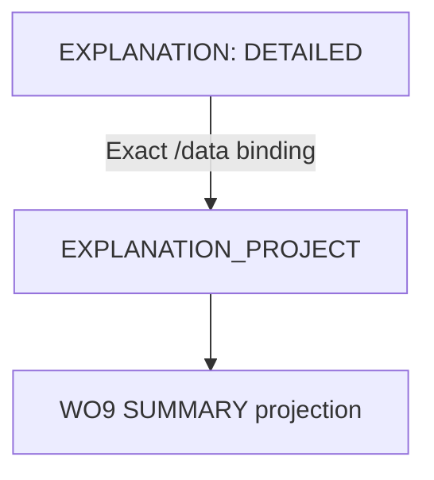

# M4 Rules Evaluation Orchestration & HTTP API (M4-WO10)

**Status:** M4-WO10 — Rules Evaluation Orchestration & HTTP API. Invariants M4-I135 – M4-I162 are catalogued, with
their automated guards, in `m4-rules-engine-core.md`.

## Purpose

WO10 answers: **"Using this exact Ruleset context, these exact Actor / Build / Runtime contexts and this explicit
Evaluation Plan, run these rule operations in a deterministic sequence and return their exact results."**

This is **orchestration only**. Every operation is one call of an existing primitive: Formula (WO3), Keyword (WO4),
Requirement (WO5), Modifier (WO6), Resource (WO7), Validation (WO8) or Explanation (WO9). WO10 adds no mechanics and
no Prowess rule. The static audit forbids game operation names, binding arithmetic, automatic blocking and any
re-implementation.

| Layer | Location | Depends on |
| --- | --- | --- |
| Pure orchestrator | `packages/prowess-rules/src/orchestration/` (`model.ts`, `pointer.ts`, `plan.ts`, `orchestrate.ts`) | `@prowess/model` only |
| Application service | `apps/studio/src/rules-evaluation/service.ts` | `@prowess/db` (WO2 resolver), `@prowess/rules` |
| HTTP route | `apps/studio/app/api/rules/evaluate/route.ts` | the service and the shared API helpers |

There is no schema change, migration, evaluation history, runtime-state write or UI.

## Server flow

```
POST /api/rules/evaluate
          │
          ▼
Strict Request Validation
          │
          ▼
Exact Ruleset Selector
     ┌────┴────┐
     ▼         ▼
 Manifest    Release
     │         │
     └────┬────┘
          ▼
WO2 Exact RulesetContext
          │
          ▼
WO10 Pure Orchestrator
          │
          ▼
Rule Evaluation Run
          │
          ▼
HTTP Response
```

1. **The route** reads the strict body, makes one service call, serializes the result and maps errors centrally. It
   contains no Prisma, repository, sorting, binding or rule logic, and exposes POST only.
2. **The service** reads the exact selector, calls exactly one WO2 resolver, and hands that context to the pure
   orchestrator. For a Release, the stored hash is verified first, so a tampered Release is refused (409) before any
   orchestration.
3. **The orchestrator** validates the plan, then executes it.

## Exact Ruleset selection

```json
{ "ruleset": { "kind": "MANIFEST", "manifestId": "<uuid>" }, ... }
{ "ruleset": { "kind": "RELEASE",  "releaseId":  "<uuid>" }, ... }
```

Exactly one selector, with exactly those fields. The following are all 400 `API.INVALID_BODY`:
- a rulesetId alone, or both ids, or neither;
- a caller-supplied `manifestHash`, `releaseNumber`, version label or resolved context;
- `current` or `latest`.

There is no current, latest, active or default Ruleset, and no automatic Stable or Core Playtest. The resolved
`RulesetContext` is always built server-side by the approved WO2 / M2 services, so a network client can never forge
manifest or release provenance, hashes or rule pins. To compare two Rulesets, make two runs.

## Contexts: one exact set per run

The run's contexts are the M4-WO1 ones, reused unchanged and normalized once by WO1:
- `RulesetContext`, which is required;
- `ActorContext | null`, `BuildContext | null` and `RuntimeContext | null`.

Every step uses that same set: a step has no context field, so it cannot override the Ruleset or any other context.
Every executed child receives the same exact `RulesetContext` and records the same provenance.

Context keys mean nothing to WO10: `ACTOR /stats/divisor` is just a path.

## EvaluationPlan

```
EvaluationPlan { steps[], primaryStepKey?, validationStepKey?, explanationStepKey? }
EvaluationStep { stepKey, order, operation, input, bindings[] }
```

- **Identity:** `stepKey` is exact. An identical duplicate collapses; a conflicting one is `DUPLICATE_STEP`.
- **Order:** `order` ascending, then `stepKey` in UTF-16 code units. Input array order and binding array order never
  matter, and steps may share an order.
- **Operations:** a closed, static set of 14, dispatched through one exhaustive `switch`. There is no registry,
  dynamic import, string lookup or callback.

| Operation | Primitive | Input fields |
| --- | --- | --- |
| `FORMULA` | `evaluateFormula` | `program`, `variables` |
| `KEYWORD` | `resolveKeywords` | `contributions` |
| `REQUIREMENT` | `evaluateRequirement` | `requirement`, `facts` |
| `MODIFIER` | `evaluateModifiers` | `request` |
| `RESOURCE_SPEND` / `_RESTORE` / `_SET_CURRENT` / `_RESERVE_CAPACITY` / `_RELEASE_CAPACITY` / `_REFRESH` | the WO7 transitions | `snapshot`, `request` |
| `RESOURCE_PAYMENT_PREVIEW` / `RESOURCE_PAYMENT_APPLY` | `previewResourcePayment` / `applyResourcePayment` | `snapshot`, `payment` |
| `VALIDATION` | `evaluateValidation` | `request` |
| `EXPLANATION` | `buildExplanation` | `input` |

There are no M5 operations (`SPELL_COST`, `MANA_LOCK`, …). Primitives remain authoritative for their own semantic
validation: WO10 checks only orchestration shape and reference safety.

- **Designations** are optional and explicit:
  - `primaryStepKey` must name a step;
  - `validationStepKey` must name a VALIDATION step;
  - `explanationStepKey` must name an EXPLANATION step.

  None is ever inferred. Validation and explanation happen only when the plan includes them as steps.

```
Step 10 Formula
      │
      ▼
Step 20 Modifier
      │
      ├─────────────┐
      ▼             │
Step 30 Formula     │
      │             │
      ▼             │
Step 40 Resource ◄──┘
      │
      ▼
Step 50 Validation
      │
      ▼
Step 60 Explanation
```

## Bindings: exact copies, no calculation

```
EvaluationBinding { target, source }
source = { kind: "CONTEXT", context: RULESET | ACTOR | BUILD | RUNTIME, pointer }
       | { kind: "STEP", stepKey, pointer }
```

- **Pointers** are RFC 6901 JSON Pointers. `""` is the root, meaning a whole context or a whole prior
  `RuleEngineResponse`; whole responses are what WO8 sources and WO9 contributions need.
  - Tokens unescape `~1` and `~0`; any other `~` is invalid.
  - `__proto__`, `prototype` and `constructor` are rejected.
  - Array indexes are canonical non-negative integers: no `-`, leading zeros, wildcards or slices.
  - Reads use own data properties only; getters are never invoked.
  - There is no JSONPath and no query language.
- **Targets** are non-root pointers into the step's own input. The parent must exist in the template: an object key
  may be set, an array index must already exist. Two targets may not be equal or nested (`/a` and `/a/b`), so there
  is no last-write-wins.
- **Values** are copied verbatim into a detached copy of the template. Bindings never add, multiply, round,
  concatenate, convert or evaluate, and no transform field exists. Calculation is always a Formula step.
- **Null vs missing.** An existing path whose value is `null` is a real value. A missing path is unavailable.
- **References only point backwards.** A STEP reference must name a step that runs strictly earlier in execution
  order; self and forward references are invalid plan structure. A dependency cycle is therefore impossible by
  construction.

```
Previous Step Response

{
  data: {
    finalValue: 17
  }
}

        │
        │ exact reference
        ▼

/data/finalValue
        │
        ▼

Later Step Input

{
  listedAmount: 17
}

No calculation occurs in the binding.
```

## Execution

1. Validate everything statically knowable **before step 1**: request shape, steps, operations, input fields,
   bindings, pointers, target conflicts, reference order, designations and limits. Any defect means the orchestration
   response is INVALID (`ORCHESTRATION.*`) and nothing runs.
2. For each step in execution order, resolve every binding:
   - **CONTEXT_UNAVAILABLE:** the context family is null;
   - **REFERENCE_NOT_FOUND:** the context path is missing;
   - **DEPENDENCY_BLOCKED:** the referenced step was itself blocked;
   - **DEPENDENCY_VALUE_UNAVAILABLE:** the referenced step's response lacks the path, e.g. `/data/...` when `data` is
     null.

   Any of these makes the step **BLOCKED**: its primitive never runs, and nothing is guessed.
3. Otherwise the step is **EXECUTED** with its detached, bound input, and the primitive's exact response is stored
   unchanged.

```
EvaluationStepResult { stepKey, order, operation, executionStatus (EXECUTED | BLOCKED), response | null, blockedBy[] }
EvaluationRun        { evaluationKey, executionStatus (COMPLETE | PARTIAL), primaryStepKey, validationStepKey,
                       explanationStepKey, steps[] }
```

**Nothing short-circuits.** A blocked or invalid step never stops unrelated later steps. A whole invalid response can
still feed Validation and Explanation, because they explain invalid evaluations. `COMPLETE` means every step executed;
`PARTIAL` means at least one was blocked. These are execution-completeness states, not rule-validity states.

```
Formula A
INVALID
data = null
    │
    ├──────────────► Modifier B
    │                  BLOCKED
    │
    └──────────────► Explanation D
                      whole response available
                      EXECUTED

Requirement C
independent
EXECUTED

Run:
PARTIAL
```

### Rule validity vs orchestration validity

```
Orchestration:
Plan valid
Steps processed correctly
        │
        ▼
SUCCESSFUL ORCHESTRATION

Inside it:

Formula response = INVALID

These are not contradictory.

The orchestrator worked.
The Formula content/input was invalid.
```

The orchestration's own `RuleEngineResponse` describes only whether the plan was validly orchestrated. Child
responses keep their exact WO1 status, data, diagnostics, trace and Ruleset provenance, and each is deep-equal to a
direct primitive call. The following never block or invalidate a run:
- `satisfied: false`;
- `canPay: false`;
- `SKIPPED_CONDITION`;
- an INVALID child.

Only an explicit Validation step with explicit checks turns outcomes into findings.

`RESOURCE_PAYMENT_APPLY` is WO7's pure operation: it computes the projected immutable snapshot and persists nothing.
The orchestration trace is concise — one step per plan step with its key, operation, execution status, binding count
and child status — and never copies child traces.

## HTTP API

`POST /api/rules/evaluate` is the only rules route; there is no PATCH, PUT, DELETE, commit or apply-to-character
route. Body fields: `ruleset`, `evaluationKey`, `actor`, `build`, `runtime`, `plan`.

| Situation | HTTP |
| --- | --- |
| an INVALID child, `satisfied: false`, `canPay: false`, a PARTIAL run, an INVALID plan (well-shaped body) | **200**, with the orchestration RuleEngineResponse |
| malformed JSON, wrong JSON types, unknown or missing fields, bad selector | 400 `API.INVALID_BODY` |
| the addressed Manifest or Release does not exist | 404 (existing WO2 / M2 codes) |
| a Release fails its hash verification | 409 `RULESET_RESOLUTION.RELEASE_INTEGRITY_FAILURE`, before orchestration |
| unexpected failure | opaque 500 (central redaction: no stack, SQL, Prisma code, URL or path) |

- **Statelessness:** evaluation is read-only. Integration tests fingerprint every table before and after Manifest,
  Release, payment-apply, Validation and Explanation runs and find them byte-identical.
- **Security:** this is developer / internal Phase-1 infrastructure with the existing Studio conventions. No new
  authentication system is introduced.
- **Request ids:** HTTP request ids remain transport metadata and never enter Rules Engine identity. `evaluationKey`
  comes from the caller, and no time, duration or random id appears in the engine output.
- **API client:** no Studio API client is added now. WO11 is its first consumer and will add one alongside the UI
  under the existing `src/api-client` conventions.

## Listed cost / payment across the full flow (M4-I14, M4-I162)

```
Formula / Modifier
        │
        ▼
Listed Cost = 17
        │
        ├──────────────► Derived Formula → 4
        │
        ▼
Resource Payment
        │
        ├── Source A → 6
        └── Source B → 11
        │
        ▼
Resulting Runtime State

Listed Cost still 17.
Derived Result still 4.

No feedback arrow from payment to listed cost.
```

The HTTP vertical slice proves this through real exact Ruleset resolution, using one actor context value and a
bound pipeline:

| Step | Operation | Result |
| --- | --- | --- |
| 10 | Formula | 17 |
| 20 | Modifier | 17 |
| 30 | Formula on `17 / Actor.divisor`, FLOOR | 4 |
| 40 | payment of the bound listed value | 6 + 11, primary left with 9 |
| 50 | Validation | valid |
| 60 | Explanation | still shows listed 17 |

The value 17 reaches later steps only through bindings. No output contains an effective or reduced cost.

**Future Prowess reading (documentation only):** listed Spell MP 17, AP `floor(17 / PRO 4)` = 4, paid ME 6 + MP 11.
Listed MP stays 17 and AP is never recalculated from 11.

## Determinism, immutability, limits

- The same contexts and plan give byte-identical results — response, statuses, child responses, block reasons, trace
  and explanation — whatever the step or binding array order.
- Exact Manifest and Release evaluations are reproducible after newer Manifests and Releases are created.
- Caller plans, templates, contexts and responses are never mutated or frozen. Inputs are detached, and outputs are
  deep-frozen and JSON-safe. Getters, prototypes, cycles and dangerous pointer segments fail safely.
- Limits: 4,096 steps, 32,768 bindings in total and 4,096 per step, plus bounded pointer length and token count. One
  over is a controlled INVALID; nothing is truncated.
- Indexes are built once: step positions, results by key, and sorted binding targets.

## Handoff

- **M5:** a Prowess content layer will compile structured content into explicit EvaluationPlans: a Spell's
  Targeting, Effects, Traits, Affinity and Casting Conditions; Character-calculated actor values; runtime MP, ME,
  reserved capacity, conditions and active effects. WO10 does not implement that compiler and assigns those values
  no meaning.
- **WO11:** the Rules Inspector and Calculation Lab will call `POST /api/rules/evaluate` and render the run, the
  child responses and the WO9 explanation.
- **WO12:** will audit that exact stored inputs always reproduce the same run.

## Limitations

M4-WO10 does not implement: Prowess-specific rule compilation; Spell, Affinity, Mana Efficiency, Mana Lock, Sustain or
Concentration semantics; Character building; Weapon, Maneuver or Summoning calculations; persistent runtime state;
evaluation history; combat sequencing; automatic Ruleset selection; automatic Validation or Explanation policy; the
Rules Inspector or Calculation Lab UI; public player tools. No schema change, no migration.


## M4-WO10A — Explanation Projection

Approved prerequisite amendment for WO11; existing EXPLANATION behavior is unchanged.

- EXPLANATION invokes WO9 buildExplanation and returns the canonical DETAILED document.
- EXPLANATION_PROJECT invokes only WO9 projectExplanation(document, level). Named inputs are `document` and `level`; the level is explicit and validated by WO9. The closed vocabulary now has 15 operations.
- The sample binds the prior EXPLANATION response at `/data` to `/document`; it requests SUMMARY. No hidden connection, transformed pointer, or reevaluation exists.
- `explanationStepKey` still designates EXPLANATION only. Projections are separate exact steps.
- Projection receives the exact copied document and preserves WO9's own response contract verbatim, including its null response-level Ruleset provenance. Exact document/section provenance is retained; the run still carries its exact resolved Ruleset. No provenance is invented or overwritten by the adapter.
- An unavailable path or BLOCKED source uses existing dependency blocking. An existing `null` is a real copied value and is rejected by WO9 as INVALID; it is not treated as a missing path.
- M4-I162A is guarded by orchestration unit regressions and the WO11 static gate. Every projection dispatcher control must match the one direct primitive call.

This amendment adds no mechanics, route, schema, migration, persistence, or new response envelope.


