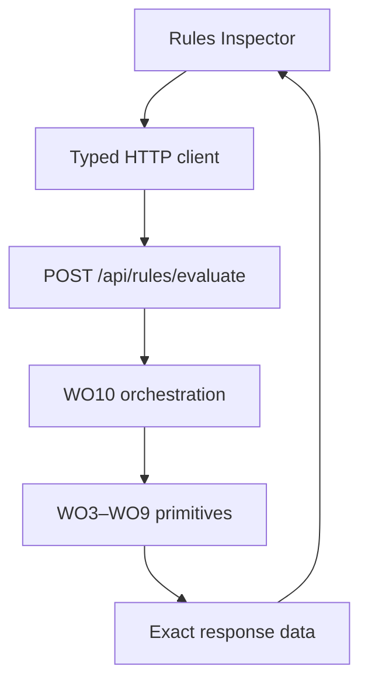
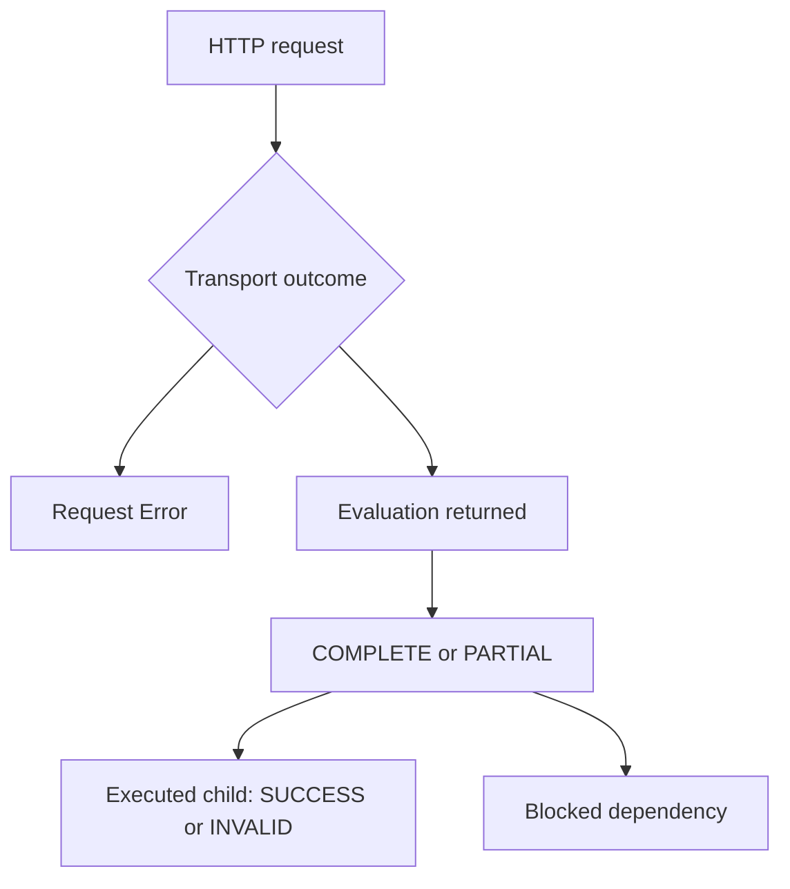
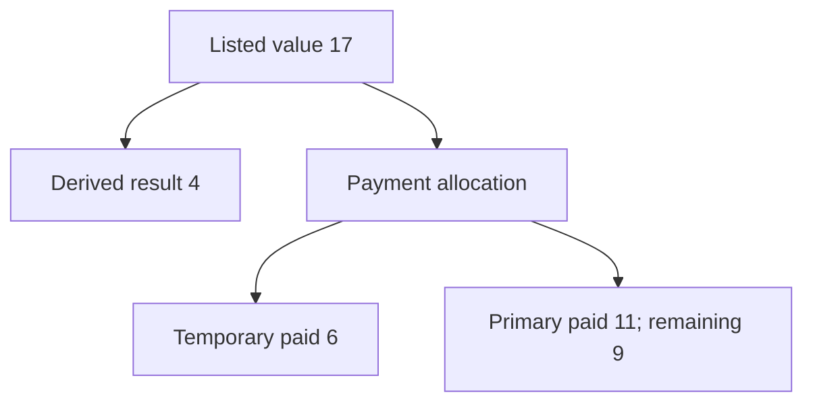

# Rules Inspector / Calculation Lab — M4-WO11

**Status: implemented; verification is recorded in the WO11 completion report. FINAL PASS requires permanent GitHub CI.**

Baseline: `main` at `53aa50067bb2cc9508a73e690e432cf19cd37d8f`. Implementation branch: `m4-wo11`.
The approved WO10A prerequisite adds one direct projection adapter before the UI. WO12 and M5 are outside this change.

## Purpose and boundary

`/developer/rules` is an internal designer/developer tool to author ephemeral generic requests and inspect exact engine output. Developer overview links to it; Compendium and player navigation do not.

The browser uses only public Rules Engine types and the closed operation/context vocabulary constants. `src/api-client/rules.ts` imports the existing WO10 request types with `import type` and uses the existing HTTP transport. No server module is bundled through that type-only import. Its only evaluation call is POST `/api/rules/evaluate`; exact RuleEngineResponses remain intact. M2 list reads provide the selector, with explicit paging beyond 100 records.

The return arrow carries data. No calculation, primitive invocation, binding transform, rule severity decision, resource allocation, rounding, or local explanation projection executes in the browser.

## Layout, accessibility and performance

The existing Studio shell, font, spacing, borders and color tokens remain authoritative. The lab uses three panes within the shell workspace, taking over the shell's reserved Inspector space on this route. Below 900px its PLAN/RUN/DETAILS tab controls choose one visible pane; all authoring and inspection actions remain available. JSON and tables scroll internally. No theme or UI framework dependency was added.

| Desktop pane | Contents | Narrow pane |
| --- | --- | --- |
| PLAN / CONTEXT | Exact selection, contexts, ordered steps, inputs, bindings, designations, Run | PLAN |
| EXECUTION / EXPLANATION | Run status, timeline, diagnostics, returned explanation selection, snapshot | RUN |
| INSPECTOR | Selected step overview, authored input, output, trace, provenance, raw data | DETAILS |

Buttons are semantic and keyboard reachable. Editors and selectors have labels; fieldsets identify bindings and contexts. Tabs expose selection, panels expose names, running/stale states use text and live status, and visible focus styles use Studio tokens. Trace/explanation expansion buttons expose `aria-expanded`. No status relies on color alone.

Step lists scroll and handle 1,000 rows without expanding nested data. Trace, explanation and Requirement branches mount deeper nodes on demand. Trace search for diagnostic links is iterative. No heavy editor or virtualization dependency was added. Large-plan and large-trace browser sanity are testable through the same generic request surface.

## Exact selection and editing

Manifest and Release modes are explicit. Neither mode nor Ruleset changes auto-selects an exact record. M2 headers supply identity, labels, Manifest version, Release number and hash where available; the selected record can be inspected as raw data. No records are created by the lab. A request sends exactly `{ kind: MANIFEST, manifestId }` or `{ kind: RELEASE, releaseId }`; it never supplies resolved RulesetContext, hashes, release numbers or pins.

Actor, Build and Runtime each have an Enabled/Null control and JSON editor. `null` is explicit. Client checking covers JSON syntax and outer object/null shape only; semantic context and operation validation remains on the server.

Steps support add/edit/duplicate/remove. Keys are explicit editable strings; convenience keys are deterministic local row suggestions. Order is editable, displayed in ascending numeric order and then code-unit stepKey order; tied orders show a warning. Operation options come from the approved public WO10/WO10A vocabulary. JSON input preserves authored values.

Bindings edit exact target pointer, Context/Prior Step source, context family/step key and source pointer. Prior-step options contain only earlier displayed steps. Empty source pointer is labelled Whole Response/Whole Context. Repeated target warnings are convenience feedback; WO10 validates conflicts and references. There is no transform feature.

Primary can designate any supported step; Validation options include VALIDATION only; Explanation options include canonical EXPLANATION only. None is inferred from the last step. An advanced JSON plan import is available for developer fixtures. Request preview shows the exact request that will be sent.

## Execution and status fidelity

Run is explicit and guarded against double submission, including a synchronous in-flight ref. Selecting records, editing inputs and loading a sample do not run evaluation. On submission the client freezes a detached request snapshot and associates it with the result. Subsequent edits mark that response STALE, including edits while a request is in flight. The old response remains tied to its old selection and snapshot. Reset confirms discarding entered state; sessions are never persisted in a database or browser storage.

Request failure clears the prior result and says evaluation did not run. Server 500 details are never displayed; the UI uses safe generic copy. A HTTP 200 response with invalid contexts/plan remains an evaluation response. A COMPLETE/PARTIAL run, child INVALID, false Requirement, skipped Modifier, or unavailable payment is never relabelled as a transport failure.

## Inspector fidelity

| Subsystem | Presentation |
| --- | --- |
| Formula | Returned variables, expressionValue/raw result, explicit rounding, bounds and finalValue; expression source remains in authored input |
| Keyword | Exact returned identities, category, contributors and provenance in technical JSON |
| Requirement | SATISFIED/NOT SATISFIED/INVALID remain distinct; returned group/leaf outcome tree expands on demand |
| Modifier | Actual outcome order, phase, key, status, before, operation, operand, after and condition; full sources/provenance available |
| Resource | Operation, request/actual amount, shortfall, state before/after, available maximum; reservation explicitly says Capacity Reserved |
| Payment | Listed value separate from ordered allocation table and resulting resource state; attempted projected allocations remain distinct from committed resulting state on insufficiency |
| Validation | ERROR/WARNING/INFO groups preserve severity, category, code, path, details and provenance |
| Explanation | Canonical designated DETAILED and explicitly selected projection results from returned responses; no projection winner is guessed |
| Trace | Exact returned path, ordinal, sibling order, key, operation, inputs, output and provenance |

Raw read-only JSON is available for the request snapshot, whole response, selected step and exact child envelope. Authored input templates are separately labelled from resolved input records in the returned trace. **WO10 has no standalone resolved-input field**: the UI does not reconstruct one. When the primitive does not expose a value, the lab does not invent it.

Explanation-to-trace links follow exact contribution-to-prior-response bindings from the evaluated request snapshot; for a projection they follow its exact `/document` binding to the canonical explanation. Diagnostic links use returned diagnostic ordinals and sourceTracePath. Generic authored documents without those explicit binding relationships have no inferred source-step mapping. Focus opens ancestors and highlights the exact trace path. Data and Rule/Ruleset/source Manifest identities remain verbatim.

## Neutral sample and golden payment boundary

The sample creates no content or Rulesets. The user chooses an exact environment record before running it through the real API.

| Order | Step | Operation |
| --- | --- | --- |
| 10 | base | FORMULA |
| 20 | listed | MODIFIER |
| 30 | derived | FORMULA |
| 40 | payment | RESOURCE_PAYMENT_APPLY |
| 50 | validation | VALIDATION |
| 60 | explanation | EXPLANATION |
| 70 | summary | EXPLANATION_PROJECT |

Returned listed value stays 17; derived value is 4; payment uses temporary 6 and primary 11; primary remains 9. The browser renders these fields without recomputing them.

There is no payment feedback into listed value. Payment allocations on an unaffordable request are explicitly labelled projected; resulting resource state is rendered from the engine's atomic result.

## Guards, persistence and handoff

The invariant catalog adds M4-I163–I188 without changing prior numbering; M4-I162A records WO10A. `m4-wo11-invariants.json` maps every UI invariant to permanent guard files. `m4-wo11-baseline.json` pins the existing schema and all 22 migrations. The named WO11 CI gate runs the static audit, client and component suites; existing WO1–WO10 gates remain. Playwright's normal inventory includes `rules-inspector.spec.ts` against real test-database HTTP routes. API integration verifies the entire database read-only; E2E fingerprints scoped fixture records because other spec workers create unrelated fixtures concurrently.

Negative controls cover local evaluation/projection, rounding, effective cost, database/Prisma imports, latest selection, game branches, automatic Requirement/Resource blocking and hidden network writes. WO10A additionally pins the projection case to one exact direct primitive call, catching rebuilds and every prohibited evaluator/arithmetic/persistence replacement.

WO12 receives a stable generic interactive surface and the exact 17/4/6+11 fixtures; it must independently audit the complete system. WO12 is not started here. M5 can later provide structured Prowess content and compilers that target these primitives.

Limitations: no game-specific authoring, Spell/Character/Weapon/Maneuver/Equipment/Summon editors, Canon editing, persistent lab sessions, combat/campaign execution, player-facing Inspector, multi-run comparison, AI explanation, runtime Character mutations or standalone resolved-input reconstruction. Projection documents are displayed distinctly by step identity; the UI never chooses among multiple projections implicitly.
