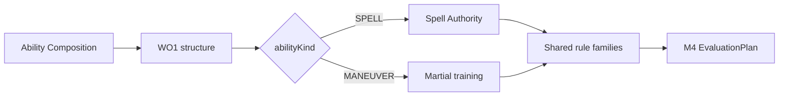
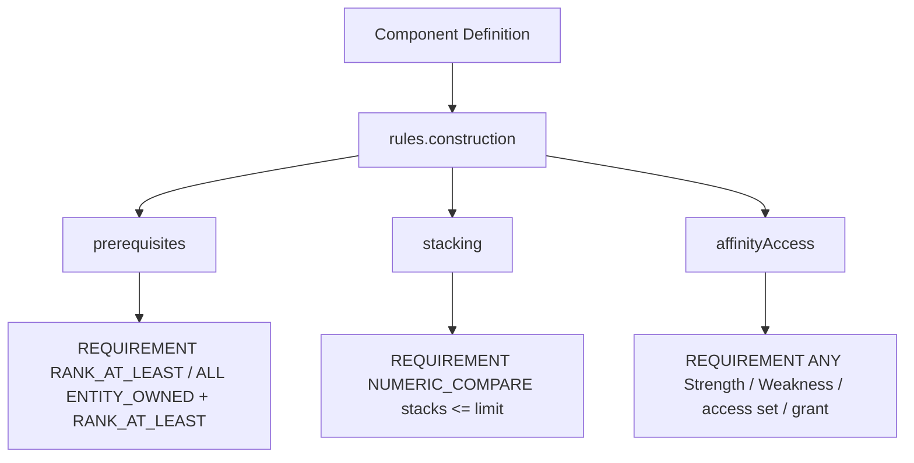
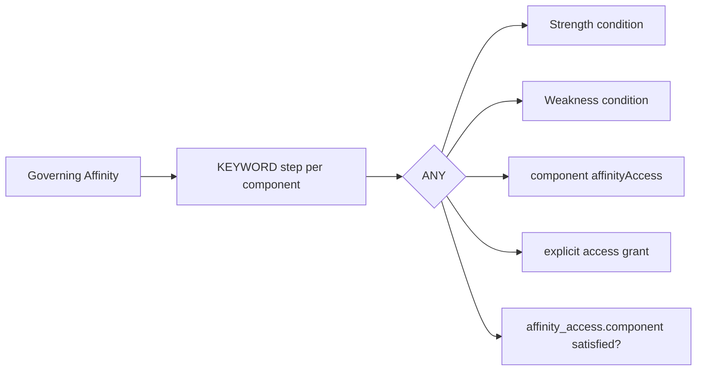
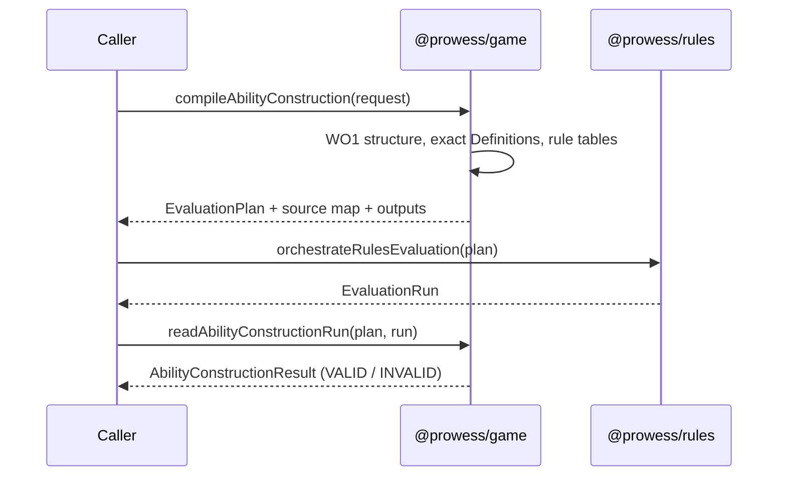
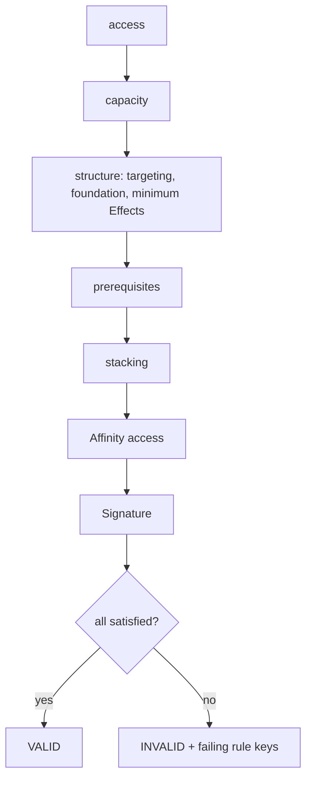
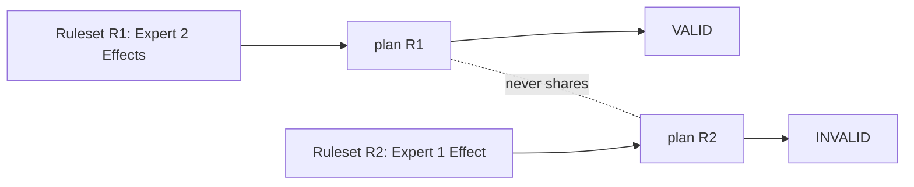

# M5-WO5 — Shared Modular Ability Construction Framework

PAS-10 M5-WO5 (Work Order v1.0 with the Martial addendum §A1–§A12). This document describes how `@prowess/game` decides
whether a specific character may construct a specific Spell or Maneuver. It covers access, capacity, structure,
prerequisites, stacking, Affinity access and Signature slots. Every number is versioned Definition content and every
comparison is an M4 step.

Guarded by `M5-I156`, `M5-I157` and `M5-I158` (see `m5-invariants.md`) and by the CI gate
**"M5-WO5 audit — Shared modular ability construction"**.

## 1. Scope

WO1 built the shape of an Ability Composition. WO4 built the Affinity identity, rank and Authority capacity. WO5 makes a
composition **legal or illegal for a character**, and gives M4 evidence for every rule.

- **In scope:**
  - Spell access through an explicit Authority, and Maneuver access through Martial training.
  - Effect, Trait and Condition capacity, the Spell Trait exchange, at least one Effect, and a single Targeting slot.
  - The Maneuver Foundation.
  - Component prerequisites, explicit Effect stacking and Affinity access.
  - Signature Ability slots, with explicit exemptions.
- **Out of scope:**
  - Any cost (MP, AP, Casting Condition percentages, final rounding): WO10 / WO11.
  - Effect resolution and chains: WO12.
  - Catalog content (Targeting, Effect, Trait, Duration, Condition): WO6–WO9.
  - Character builder UI, new endpoints and a full Character model.

## 2. Source Authority

Precedence follows M5-WO1: designer rulings, then approved CanonDecisions, then Core Playtest V0.1, then older sources.
The construction rule cites these locators: s121–s123 (Signature), s185 / s190 / s198 (Arcana), s624 / s626 / s627
(capacity, exchange), s669 / s676, s680–s683 (Authorities), s1980–s1983 (Martial) and s2018 / s2020 (Maneuver
Conditions). It also cites these conflicts: M5-SC-011, M5-SC-015, M5-SC-017, M5-SC-021, M5-SC-022 and M5-SC-025.

## 3. Designer Rulings

The construction content records the locked rulings in `designerRulings`:

| Ruling | Applied as |
| --- | --- |
| Spell access | Arcane Authority (Arcane Rank TRAINED+) or Affinity Authority (governing Affinity owned TRAINED+). Explicit, never auto-switched |
| Martial Rank | The Martial Skill's rank. Rank Value TRAINED 1 · EXPERT 2 · MASTER 3. TRAINED is the Maneuver minimum |
| Trait exchange | Spells only. 1 unused Effect slot → +1 Trait slot, requested explicitly, at least 1 Effect kept |
| Arcane capacity | TRAINED 1/1 · EXPERT 2/2 · MASTER 3/3 Effects/Traits. Arcane and Affinity capacities never add |
| Casting Conditions | Capacity from Arcane Rank only: UNTRAINED 0 · TRAINED 1 · EXPERT 2 · MASTER 3 |
| Signature slots | 1 per Ability. 0 only through an explicit authored exemption. Capacity = `SIGNATURE_ABILITY_SLOTS` (= PRO) |
| Stacking | Only when the Effect Definition allows it. Stacks share 1 slot within the Definition's own limit. No universal limit |
| Martial addendum | Affinity is an access layer only. It never substitutes for Martial training or adds Maneuver capacity |

## 4. Boundaries

- `@prowess/rules` (M4) is byte-identical to the WO2 baseline (`m5-wo5-baseline.json`). No M4 change was needed.
- There is no Prisma schema change, no migration, no new endpoint and no UI. Plans run through the existing
  `POST /api/rules/evaluate`.
- `@prowess/game` stays pure. It depends on `@prowess/model` and `@prowess/rules` only, and has no DB, clock,
  randomness or global state.
- The WO1 structure check (`validateAbilityComposition`) is unchanged and still runs first. A cross-branch component is
  a WO1 error, never a WO5 INVALID.

## 5. Shared Grammar

Spells and Maneuvers are two branches of one grammar. One compiler (`compileAbilityConstruction`) serves both. Rule
families are shared, and the branch only selects which authored table is read.

## 6. Rank Tracks

Both construction tracks are **Skill ranks** on the SKILL rank ladder (`core.rank_ladder.skill`: UNTRAINED, TRAINED,
EXPERT, MASTER).

- Arcane Rank is the `skill.arcana` rank (M5-SC-011).
- Martial Rank is the `skill.martial` rank.

A Skill missing from the character context is at the ladder's first rank. Rank order always comes from the ladder
Definition, never from string comparison. A request that carries a separate `arcaneRank` or `martialRank` field is
refused.

## 7. Arcane Authority

Arcane Authority requires Arcana TRAINED+ (M4 `RANK_AT_LEAST`). Its capacity comes from
`spell.arcaneAuthority.ranks` in the construction rule. Arcane is the broad path: components still need their own
prerequisites, but no Affinity access is checked.

## 8. Affinity Authority Reuse

Affinity Authority requires the composition's governing Affinity to be owned (`ENTITY_OWNED`) at TRAINED+
(`RANK_AT_LEAST` from the WO4 `AFFINITY_RANK_RULE`). Its Effect / Trait capacity **is** the WO4 rank-rule table:
`capacitySource: AFFINITY_RANK_RULE`. Nothing is duplicated. An unowned Affinity is held at NONE, which has no
capacity. Every non-Affinity component must also be within the Affinity's access (§20).

## 9. Martial Rank

A Maneuver requires Martial TRAINED+. The rule authors, per rank, `martialRankValue` together with Effect, Trait and
Condition capacity (0 / 1 / 2 / 3). Rank Value is read only by mechanics that say so, such as a stack limit of kind
`TRACK_RANK_VALUE` with track MARTIAL. Owning an Affinity never substitutes for Martial training (M5-I158).

## 10. Construction Rule Contract

There is one `ABILITY_CONSTRUCTION_RULE` Definition (family ABILITY, schemaVersion 1): `construction.ability_rules` in
`content/core-playtest-v0.1/ability-construction.json`. Its fields:

- `rankLadder`
- `formulas`: `remainingEffects`, `effectiveTraits`, `maximumTrades`, `signatureProjected` and
  `signatureAvailable`. These are M4 Formula programs whose variables are restricted per slot.
- `spell`: `arcaneAuthority`, `affinityAuthority`, `castingConditions`, `minimumEffects` and `traitExchange`.
- `maneuver`: `martial`, `minimumEffects`, `foundationRequired` and `traitExchange: null`.
- `signature`: `capacityStatistic`, `defaultSlotCost`, `exemptSlotCost` and `exemptions`.
- `source`

Validation rules:

- Every rank table must cover exactly the ladder's ranks. Otherwise the result is `CONSTRUCTION_RULE_UNRESOLVED`;
  there is no implicit zero row.
- Formula programs are validated by M4's own `validateFormulaProgram`.

## 11. Effect Capacity

Base Effect capacity comes from the governing table: Arcane, Affinity rank rule or Martial. Remaining capacity is
computed by M4: `base_effects - trades * effect_slots_per_exchange`. A REQUIREMENT `NUMERIC_COMPARE <=` then compares
the Effect slot count against it through a binding. Each Effect use takes one slot, whatever its stack count.

## 12. Trait Capacity

Effective Trait capacity is computed by M4: `base_traits + trades * trait_slots_per_exchange`. It is compared against
the Trait slot count.

## 13. Spell Trait Exchange

The exchange is requested explicitly (`options.effectSlotsTradedForTraits`). It is never inferred from unused capacity.
M4 computes the most trades allowed: `floor((base_effects - minimum_effects_remaining) / effect_slots_per_exchange)`,
with a minimum of 0. That gives Trained 0, Expert 1 and Master 2. Maneuvers have no exchange (`traitExchange: null`),
so 0 trades are allowed.

## 14. Casting Condition Capacity

Casting Condition capacity comes from `spell.castingConditions` with `capacitySource: ARCANE_RANK`, read from the Arcana
rank **whatever the Authority** (M5-I157). An Affinity-only caster with Arcana UNTRAINED has 0.

## 15. Maneuver Condition Capacity

Maneuver Condition capacity comes from the Martial row's `conditionCapacity`: TRAINED 1, EXPERT 2, MASTER 3.

## 16. Minimum Effects And Targeting

Every Spell and Maneuver needs at least `minimumEffects` (1) Effect. An Ability has exactly one Targeting slot (M5-SC-022);
the composition's targeting component count is compared `== 1`.

## 17. Maneuver Foundation

A Maneuver names a `MANEUVER_FOUNDATION` Definition. WO5 activates that kind's structural v1 contract
(`foundationKind`), with no formula and no cost. The rule's `foundationRequired: true` is checked as an M4 requirement.

## 18. Component Prerequisites

A component may author `rules.construction.prerequisites`. Each prerequisite is one of:

- `SKILL_RANK_AT_LEAST { skillKey, minimumRank }`
- `AFFINITY_RANK_AT_LEAST { affinity (exact ref), minimumRank }`

Each prerequisite compiles to one REQUIREMENT. Prose prerequisites are refused (`INVALID_COMPONENT_CONSTRUCTION_RULES`).

## 19. Effect Stacking

Stacking is allowed only by `stacking: { stackable: true, limit }`. The limit is either:

- `FIXED { maximum }`, or
- `TRACK_RANK_VALUE { track }`. MARTIAL reads `martialRankValue`. ARCANE is `CONSTRUCTION_RULE_UNRESOLVED`, because no
  Arcane Rank Value is authored.

A non-stackable Effect is limited to one stack. A repeated Effect use takes another slot, because separate uses are never
merged.

## 20. Affinity Access

Under Affinity Authority, every non-Affinity component must be within the governing Affinity's access. The check is ANY
of the following:

- the Affinity's Strength Keyword conditions;
- its Weakness conditions (a Weakness match is still access, as in WO4);
- the component's own `affinityAccess` listing the governing Affinity;
- an explicit request `accessGrants` entry.

The KEYWORD steps come from the WO4 `AffinityEmitter`.

## 21. Signature Ability Slots

Capacity is the WO2 derived statistic `core.derived.signature_ability_slots` (formula `pro`), emitted with its own
program. The steps run in this order:

1. projected = `used_slots + candidate_slots`
2. requirement: projected ≤ capacity
3. available = `capacity - projected`

All three are M4 steps.

## 22. Signature Exemptions

A candidate with `slotUse: EXEMPT` costs `exemptSlotCost` (0). It must name an `exemptionKey` that the rule authors
(`SET_CONTAINS`). Canonical content authors none yet, so every zero-slot use fails until a rule names one. There is no
`isFree` flag and no anonymous free use.

## 23. Construction Request

The request contains:

- `contractVersion` and `subjectKey`
- `composition`: the WO1 composition, plus `authority` for Spells
- `definitions` and `ruleset`
- `character`: `stats`, `skillRanks`, `affinityProfile`
- `keywords`
- `options.effectSlotsTradedForTraits`
- `signature`: `usedSlots` and `candidate`
- `accessGrants`

Plain-data validation rejects getters, cycles, NaN / Infinity, unsafe keys and functions.

## 24. M4 Mapping

| Check | M4 operation |
| --- | --- |
| Access | REQUIREMENT `RANK_AT_LEAST` (Skill) or `ALL [ENTITY_OWNED, RANK_AT_LEAST]` (Affinity) |
| Capacity, trades, Signature arithmetic | FORMULA (programs from content) |
| Capacity / trade / Signature comparisons | REQUIREMENT `NUMERIC_COMPARE`, expected bound from FORMULA results |
| Targeting, Foundation, minimum Effects, stacks | REQUIREMENT `NUMERIC_COMPARE` |
| Affinity keywords | KEYWORD (WO4 emitter) |
| Affinity access, exemptions | REQUIREMENT `ANY` / `SET_CONTAINS` / `KEYWORD_PRESENT` |

## 25. Results

`AbilityConstructionResult` contains:

- `status` (VALID / INVALID)
- `access`
- `capacity` (effects, traits, conditions, trades)
- `usage`
- `prerequisites`
- `stacking`
- `affinityAccess`
- `signature` (capacity, projected, availableAfter, exemption)
- `rules[]`, each with satisfied and outcome
- `problems`: the failing rule keys, in plan order

Every number is read from the run. The reader re-computes nothing.

## 26. Provenance

Every step's source-map entry cites its exact Definitions:

- Access cites the construction rule and the Skill ladder.
- Affinity capacity cites the rule and `affinity.rank_rule`.
- The Signature capacity cites `core.derived.signature_ability_slots`.
- A prerequisite cites its component and the ladder.

## 27. Historical Reproducibility

Definitions are resolved through the request's exact Ruleset bundle. A bundle from another Ruleset is refused. The test
scenario: R1 re-evaluates identically after R2 changes Arcane Expert capacity, and interleaved R1 / R2 evaluations never
cross-contaminate. Nothing is persisted during evaluation.

## 28. Determinism And Plain Data

Equal requests give deep-equal plans, runs and results. Inputs are never mutated, outputs are deep-frozen, and plans
survive a JSON round-trip and replay identically through M4.

## 29. Error Codes

`PROWESS_CONSTRUCTION.*` codes:

- `INVALID_CONSTRUCTION_REQUEST`
- `MISSING_CONSTRUCTION_DEFINITION`
- `AMBIGUOUS_CONSTRUCTION_DEFINITION`
- `INVALID_CONSTRUCTION_CONTEXT`
- `AUTHORITY_REQUIRED`
- `AUTHORITY_NOT_APPLICABLE`
- `INVALID_COMPONENT_CONSTRUCTION_RULES`
- `CONSTRUCTION_RULE_UNRESOLVED`
- `UNSUPPORTED_SIGNATURE_FORMULA`
- `INCOMPLETE_RUN`

These codes mean a malformed request or Definition. An illegal construction is a VALID run whose result is INVALID.

## 30. Invariants

- **M5-I156** — Spell Authority is explicit. Arcane Authority reads Arcana TRAINED+, Affinity Authority reads the
  governing Affinity owned TRAINED+, and the compiler never auto-switches between them.
- **M5-I157** — Casting Condition capacity comes from Arcane Rank only: 0 / 1 / 2 / 3.
- **M5-I158** — Martial TRAINED is the Maneuver minimum. Martial Rank is the Martial Skill rank, and Affinity never
  substitutes for it or adds capacity.

## 31. Remaining Conflicts And Deferred Work

- The Casting Condition 30% cost cap (M5-SC-021) and every MP / AP cost are WO10 / WO11.
- Catalog content (WO6–WO9) will author the real prerequisites, stacking, Affinity access and Foundations. WO5
  exercises them through test fixtures only.
- No Signature exemption is authored yet. When the designer authors one, it is a content revision.
- An Arcane Rank Value is not authored. A stack limit on the Arcane track fails closed.
- WO5 does not begin M5-WO6.
